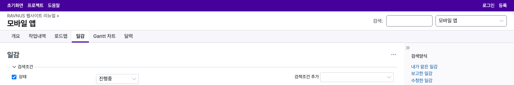
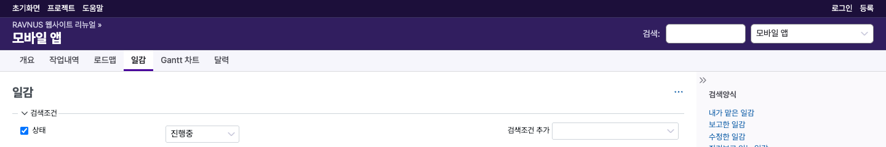
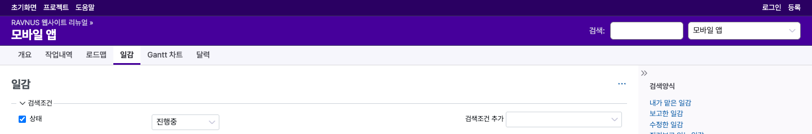
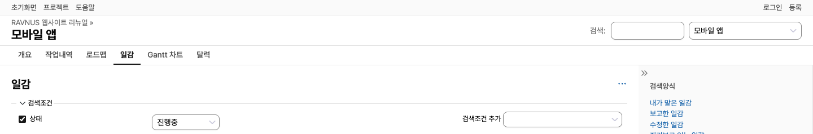
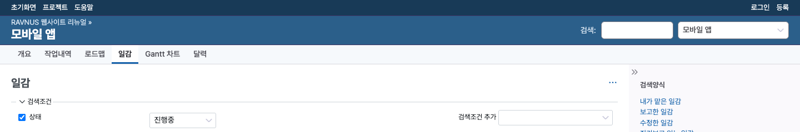

# RAVNUS — Redmine 테마

[English](README.md)

RAVNUS는 Redmine 7.x용 무료 오픈소스 테마입니다. 한국어·일본어·중국어(CJK) 사용자에게 가장 읽기 좋은 Redmine 테마를 목표로 합니다.

> **현재 상태: v0.2.1 (2026-10-18 릴리스).** v0.1.0은 기본 Redmine 화면 위에 디자인 토큰과 CJK 타이포그래피를 더했습니다. UI 언어별 글꼴 스택, 줄바꿈, 행간, 글자 크기, 폼 컨트롤 글꼴, 문장 속 링크 밑줄이 여기에 해당합니다. v0.2.0은 여기에 크롬(상단 바, 헤더, 메뉴 바, 모바일 헤더와 flyout 메뉴), 사이드바, 일감 목록(밀도, 우선순위·상태 글리프, 행 상태, 그룹 행, 선택 행, 인쇄와 강제 색 모드)도 칠합니다. 링크·버튼·폼·일감 상세 화면의 색은 그 뒤 릴리스에서 바뀝니다. 일부 회색 글자, 바닥글, 아바타 이니셜은 Redmine 기본 색을 그대로 써서 WCAG AA 명암 기준에 못 미치며, 뒤 릴리스에서 다시 칠합니다.

## 목표

- **CJK 우선 타이포그래피**: 기본 글꼴 Pretendard, 어절 단위 줄바꿈(`word-break: keep-all`), 한글 기준 행간. 일본어·중국어 UI는 OS의 CJK 글꼴을 먼저 씁니다
- **빌드 없이 커스터마이즈**: 디자인 토큰을 CSS 변수(`--ravnus-*`)로 제공합니다. `stylesheets/custom.css`나 자식 테마에서 덮어쓰고, 업데이트해도 설정이 남습니다
- **Redmine 코어를 따라감**: 코어 스타일시트를 import하고 그 위에 덮어쓰므로 코어 업그레이드가 그대로 반영됨
- **MIT 라이선스**: 누구나 무료로 설치·수정·재배포 가능

## 요구 사항

- Redmine 7.x (6.x 이하는 지원하지 않습니다)
- Redmine 사용자의 브라우저가 jsDelivr(`cdn.jsdelivr.net`)에서 Pretendard 웹폰트를 받습니다. 닿지 않으면 시스템 글꼴로 표시되고, 망에 따라 추가 설정이 필요합니다. [글꼴과 CDN](#글꼴과-cdn)을 보세요.

## 설치

1. Redmine 사용자의 브라우저가 `cdn.jsdelivr.net`에 닿는지 확인합니다. 평소 쓰는 사용자 PC에서 <https://cdn.jsdelivr.net/npm/pretendard@1.3.9/dist/web/variable/pretendardvariable-dynamic-subset.css>를 열어 봅니다. 열리지 않으면(폐쇄망, 방화벽, 필터링 프록시) 먼저 [폐쇄망](#폐쇄망)을 읽어 주세요. Redmine 서버는 CDN에 닿지 않아도 됩니다.
2. Redmine 설치 경로의 `themes` 디렉터리에 clone합니다. Redmine은 디렉터리 이름으로 테마를 표시하므로 `ravnus`로 받습니다.

   ```bash
   cd /path/to/redmine
   git clone https://github.com/RAVNUS-INC/Redmine-RAVNUS-theme.git themes/ravnus
   ```

3. Redmine을 재시작한 뒤 *관리 → 설정 → 표시방식 → 테마*에서 **Ravnus**를 선택합니다.

- Redmine은 시작할 때 테마 에셋을 `public/assets`로 컴파일하므로, Redmine 실행 유저에게 이 디렉터리 쓰기 권한이 필요합니다.
- 재시작해도 바뀐 CSS가 반영되지 않으면(예: 옛 타임스탬프로 파일을 복사한 경우) 바꾼 파일을 `touch`한 뒤 다시 재시작합니다. Redmine은 manifest보다 새로운 에셋 파일이 있을 때만 기동 때 다시 컴파일합니다.
- 업데이트는 `themes/ravnus`에서 `git pull --autostash` 후 Redmine을 재시작합니다. [업데이트](#업데이트)를 보세요.

## 글꼴과 CDN

### Pretendard

RAVNUS는 [Pretendard](https://github.com/orioncactus/pretendard)(© Kil Hyung-jin)를 씁니다. Pretendard는 예약 글꼴명(Reserved Font Name) "Pretendard"와 함께 [SIL Open Font License 1.1](https://openfontlicense.org)로 배포됩니다. 이 테마는 글꼴 파일을 배포하지 않습니다. 테마 스타일시트의 `@font-face`가 jsDelivr에서 Pretendard Variable 1.3.9의 동적 서브셋을 고치지 않은 그대로 불러오고, 브라우저는 페이지에 쓰인 조각만 받습니다. 업스트림 저작권·라이선스 고지는 `stylesheets/application.css`에 그대로 들어 있습니다.

한국어·영어 등의 UI는 Pretendard를 먼저 씁니다. 일본어·중국어 간체·중국어 번체 UI는 OS의 CJK 글꼴을 먼저 쓰고 Pretendard는 한글만 맡습니다.

### 개인정보

- 방문자의 브라우저가 jsDelivr에 직접 글꼴을 요청하므로 방문자 IP가 jsDelivr로 갑니다.
- Redmine의 origin(스킴, 호스트, 포트)도 jsDelivr로 갑니다.
  - 글꼴 요청은 CORS 요청이므로 `Origin` 헤더로 갑니다.
  - `Referer` 헤더로도 갑니다. Redmine 7.0.2 기본 헤더에서는 경로 없는 Redmine origin이었고, 페이지 경로는 한 번도 가지 않았습니다.
- 글꼴 요청의 `Referer`는 페이지가 아니라 테마 스타일시트의 referrer 정책을 따르므로, 페이지 응답의 정책만 바꾸면 효과가 없습니다. `/assets` 응답에 `Referrer-Policy: no-referrer`를 보내면 `Referer`는 빠지지만 `Origin`은 남습니다. 둘 다 보내지 않으려면 [글꼴을 자체 호스팅](#글꼴-자체-호스팅)하거나 [시스템 글꼴만](#시스템-글꼴만-쓰기) 씁니다.
- 위 내용은 로컬 테스트 환경의 Redmine 7.0.2와 Chrome에서 관찰한 것입니다. Firefox와 Safari는 확인하지 않았습니다.

### 콘텐츠 보안 정책(CSP)

리버스 프록시 등에서 CSP를 거는 설치는 `font-src https://cdn.jsdelivr.net`을 허용하거나 글꼴을 자체 호스팅합니다. 테마는 CDN에서 스타일시트를 불러오지 않으므로 `style-src`는 바꿀 필요가 없습니다. 기본 설정의 Redmine 7.0.2는 CSP 헤더를 보내지 않습니다(도커 이미지에서 확인).

### 폐쇄망

- 브라우저가 jsDelivr에 닿지 않으면 시스템 글꼴로 표시됩니다. 그래도 Pretendard를 쓰려면 [자체 호스팅](#글꼴-자체-호스팅)합니다.
- jsDelivr 요청이 바로 실패하는 환경(DNS 실패, 연결 거절)은 시스템 글꼴로 바뀌는 것 말고는 영향이 없습니다.
- **jsDelivr 요청을 응답 없이 버리는 망**(일부 방화벽·폐쇄망)에서는 [시스템 글꼴만 쓰기](#시스템-글꼴만-쓰기) 블록이나 [자체 호스팅](#글꼴-자체-호스팅)이 **필수**입니다.
  - 증상은 빈 화면이 아닙니다. 화면은 정상으로 뜨지만, 페이지마다 글꼴 요청이 시간 초과될 때까지 `load` 이벤트가 늦어집니다. 우리 시험에서는 macOS에서 225–300초였고, 지연 시간은 OS와 망 설정에 따라 다릅니다.
  - Redmine의 "저장하지 않은 변경" 경고는 `load` 때 켜집니다. 그 전에는 편집 중에 다른 페이지로 가면 입력이 경고 없이 사라집니다. `load` 전에 입력하고 포커스를 옮긴 텍스트 영역은 `load` 뒤에도 보호되지 않습니다.

### 중국 본토

자체 호스팅을 권합니다. jsDelivr는 2021-12-20 중국 ICP 라이선스를 잃었다고 공지했고, 유지관리자는 그 뒤 중국 본토 트래픽을 본토 밖 CDN이 맡아 느릴 수 있다고 밝혔습니다([jsdelivr/jsdelivr#18348](https://github.com/jsdelivr/jsdelivr/issues/18348), [#18552](https://github.com/jsdelivr/jsdelivr/issues/18552)). 지금 중국 본토에서의 속도와 접근성은 확인하지 않았습니다.

### 캐시

jsDelivr는 글꼴에 1년짜리 자체 캐시 헤더를 보냅니다. Redmine 7.0.2 도커 이미지의 `/assets` 응답(테마 CSS, 테마 안에 둔 자체 호스팅 글꼴)에는 `Cache-Control` 헤더가 없습니다. 리버스 프록시에서 `/assets`에 `Cache-Control: public, max-age=31536000, immutable`을 설정하세요. 파일 이름에 내용 digest가 붙으므로 장기 캐시가 안전합니다.

## 커스터마이즈

모든 디자인 토큰은 `--ravnus-*` 이름의 CSS 변수입니다. 테마는 기본값을 명시도 0인 `:where(:root)`에 선언하므로, 직접 쓴 `:root { … }` 블록이 언제나 이깁니다. 빌드는 필요 없습니다.

`stylesheets/application.css`는 고치지 마세요. 컴파일된 스타일시트라 업데이트할 때마다 바뀝니다.

### custom.css

`stylesheets/custom.css`는 저장소가 추적하는 빈 파일입니다. 테마가 Redmine 코어 스타일시트 바로 다음에 import합니다. 여기에 토큰을 적고 Redmine을 재시작합니다.

```css
:root {
  --ravnus-accent: #0b6e4f;
  --ravnus-topbar-fg-muted: #d3e6df;  /* 강조색과 함께 바꾼다 (아래) */
  --ravnus-topbar-focus: #ffffff;     /* 강조색과 함께 바꾼다 (아래) */
}
```

- 토큰은 `:root`에서 바꿉니다. 파생 토큰(hover, active, 틴트 색)은 선언된 곳에서 계산되므로 `:root`에서 바꾼 노브를 따라갑니다.
- 리터럴 값을 씁니다. 직접 쓴 블록의 `color-mix()`는 `color-mix()`를 지원하지 않는 브라우저에서 폴백이 없고, 테마의 폴백 값은 기본값만 따르고 바꾼 노브는 따르지 않습니다.
- `custom.css`는 테마 규칙보다 먼저 로드됩니다. 토큰이 아닌 테마 규칙을 덮으려면 테마보다 명시도가 한 단계 높은 셀렉터를 씁니다.
- 상단 바는 `--ravnus-accent`를 따릅니다. 그러나 `--ravnus-topbar-fg-muted`(`#CAC5EA`)와 `--ravnus-topbar-focus`(`#FEA800`, 앰버 포커스 링)는 기본 보라에 맞춘 고정값이므로, 강조색을 바꿀 때 함께 바꿉니다. `#0b6e4f` 위에서 기본 보조 글자는 명암비 3.78:1(AA 기준 4.5:1 미달), 앰버 링은 3.22:1입니다.
- 고친 뒤에는 Redmine을 재시작합니다. Redmine은 manifest보다 새로운 파일이 있을 때만 기동 때 에셋을 다시 컴파일합니다. `custom.css`를 옛 타임스탬프 그대로 복사했다면(`cp -p`, `rsync -a`, 시각을 보존하는 압축 해제) `touch`한 뒤 다시 재시작합니다. 편집기로 저장하거나 `git pull`로 받은 파일은 해당하지 않습니다.

### 업데이트

업스트림의 `custom.css`는 계속 빈 파일이므로 업데이트가 고친 내용과 충돌하지 않습니다.

- `themes/ravnus`에서 `git pull --autostash`를 실행한 뒤 Redmine을 재시작합니다. git 기본 설정(merge)에서는 그냥 `git pull`도 되지만, `pull.rebase`가 `true`이면 unstaged changes 때문에 거부됩니다. 고친 내용을 로컬 브랜치에 커밋하고 `git pull --rebase`를 써도 됩니다.
- zip 파일로 다시 설치하면 `custom.css`가 덮입니다. 사본을 두거나 자식 테마를 쓰세요.

### 자식 테마

자식 테마를 쓰면 설정을 테마 디렉터리 밖에, 예를 들어 조직의 별도 비공개 저장소에 둘 수 있습니다. 글꼴을 자체 호스팅할 때도 자식 테마를 권합니다.

```text
themes/
├── ravnus/              # 이 테마. 디렉터리 이름은 ravnus여야 합니다
└── mytheme/
    └── stylesheets/
        └── application.css
```

```css
/* themes/mytheme/stylesheets/application.css */
@import url(../ravnus/application.css);

:root {
  --ravnus-accent: #0b6e4f;
  --ravnus-topbar-fg-muted: #d3e6df;
  --ravnus-topbar-focus: #ffffff;
}
```

Redmine을 재시작하고 *관리 → 설정 → 표시방식 → 테마*에서 자식 테마(여기서는 **Mytheme**로 표시)를 선택합니다.

- import는 반드시 `@import url(../ravnus/application.css);`로 씁니다. `@import url(/themes/ravnus/application.css);`도 됩니다. Redmine이 기동 때 둘 다 컴파일된 부모 스타일시트 주소로 바꿉니다.
- 다음 형식은 **동작하지 않습니다**: Redmine 5.x 경로 `@import url(../../ravnus/stylesheets/application.css);`와 문자열 형식 `@import "../ravnus/application.css";`. Redmine이 주소를 바꾸지 않아 import가 404로 실패하고, 페이지의 스타일이 모두 빠집니다.
- 자식 테마와 부모 `custom.css`가 같은 토큰을 바꾸면 자식 테마가 이깁니다(명시도가 같고 순서가 뒤). 부모 `custom.css`를 고친 뒤 Redmine을 재시작하면 자식 테마에도 반영됩니다.

### 글꼴 스택

UI 글꼴 스택 토큰은 네 개입니다: `--ravnus-font-sans`(한국어·영어 등의 UI), `--ravnus-font-sans-ja`, `--ravnus-font-sans-zh`, `--ravnus-font-sans-zh-tw`. 네 개 모두 CDN 글꼴 `"Pretendard Variable"`을 가리킵니다. 브라우저는 쓰이는 스택에 이름이 있을 때만 웹폰트를 요청합니다. jsDelivr 요청을 없애려면 **네 스택 모두**에서 `"Pretendard Variable", Pretendard`를 바꿉니다. `--ravnus-font-sans`만 바꾸면 일본어·중국어 UI는 한글을 위해 계속 Pretendard를 요청합니다.

#### 시스템 글꼴만 쓰기

이 블록을 `custom.css`나 자식 테마에 넣습니다. 그러면 jsDelivr에 글꼴을 요청하지 않습니다.

```css
:root {
  --ravnus-font-sans: -apple-system, BlinkMacSystemFont, system-ui, "Apple SD Gothic Neo", "Malgun Gothic",
    "Noto Sans KR", "Noto Sans CJK KR", "Segoe UI", Roboto, "Helvetica Neue", "Apple Color Emoji",
    "Segoe UI Emoji", "Segoe UI Symbol", sans-serif;
  --ravnus-font-sans-ja: -apple-system, BlinkMacSystemFont, "Segoe UI", "Hiragino Sans",
    "Hiragino Kaku Gothic ProN", "RAVNUS Yu Gothic", Meiryo, "Noto Sans JP", "Noto Sans CJK JP", sans-serif;
  --ravnus-font-sans-zh: -apple-system, BlinkMacSystemFont, "Segoe UI", "PingFang SC", "Hiragino Sans GB",
    "Microsoft YaHei UI", "Microsoft YaHei", "Noto Sans CJK SC", "Source Han Sans SC", sans-serif;
  --ravnus-font-sans-zh-tw: -apple-system, BlinkMacSystemFont, "Segoe UI", "PingFang TC",
    "Microsoft JhengHei UI", "Microsoft JhengHei", "Noto Sans CJK TC", "Source Han Sans TC", sans-serif;
}
```

#### 글꼴 자체 호스팅

1. Pretendard 1.3.9 배포본에서 `PretendardVariable.woff2`를 받습니다. npm 패키지에서는 `dist/web/variable/woff2/PretendardVariable.woff2`(약 2MB)이고, 라이선스 전문은 `dist/LICENSE.txt`입니다. 글꼴 파일은 고치지 않습니다.
2. 두 파일을 자식 테마의 `themes/mytheme/fonts/`에 둡니다. 라이선스 전문은 글꼴 파일 옆에 둡니다.
3. 자기 family 이름으로 글꼴을 선언합니다. OFL이 "Pretendard"를 예약 글꼴명으로 두므로 별칭에 이 이름을 넣지 않습니다. 그리고 네 스택의 `"Pretendard Variable", Pretendard`를 그 별칭으로 바꿉니다.

```css
/* themes/mytheme/stylesheets/application.css */
@import url(../ravnus/application.css);

@font-face {
  font-family: "RAVNUS Sans Local";
  font-weight: 45 920;
  font-display: swap;
  src: url(../fonts/PretendardVariable.woff2) format("woff2-variations");
}

:root {
  --ravnus-font-sans: "RAVNUS Sans Local", -apple-system, BlinkMacSystemFont, system-ui,
    "Apple SD Gothic Neo", "Malgun Gothic", "Noto Sans KR", "Noto Sans CJK KR", "Segoe UI", Roboto,
    "Helvetica Neue", "Apple Color Emoji", "Segoe UI Emoji", "Segoe UI Symbol", sans-serif;
  --ravnus-font-sans-ja: -apple-system, BlinkMacSystemFont, "Segoe UI", "Hiragino Sans",
    "Hiragino Kaku Gothic ProN", "RAVNUS Yu Gothic", Meiryo, "Noto Sans JP", "Noto Sans CJK JP",
    "RAVNUS Sans Local", sans-serif;
  --ravnus-font-sans-zh: -apple-system, BlinkMacSystemFont, "Segoe UI", "PingFang SC", "Hiragino Sans GB",
    "Microsoft YaHei UI", "Microsoft YaHei", "Noto Sans CJK SC", "Source Han Sans SC",
    "RAVNUS Sans Local", sans-serif;
  --ravnus-font-sans-zh-tw: -apple-system, BlinkMacSystemFont, "Segoe UI", "PingFang TC",
    "Microsoft JhengHei UI", "Microsoft JhengHei", "Noto Sans CJK TC", "Source Han Sans TC",
    "RAVNUS Sans Local", sans-serif;
}
```

- Redmine은 기동 때 `url(../fonts/PretendardVariable.woff2)`를 `/assets/themes/mytheme/PretendardVariable-<digest>.woff2`로 바꿉니다.
- 자식 테마 대신 `custom.css`로 자체 호스팅하려면 같은 `@font-face`와 `:root` 블록을 `custom.css`에 넣고, 파일은 `themes/ravnus/fonts/`처럼 추적하지 않는 디렉터리에 둡니다. 추적하지 않는 파일은 `git pull`에는 남지만 zip으로 다시 설치하면 사라지므로, 조직 단위 설치에는 자식 테마를 권합니다.

### 프리셋

블록 하나를 `custom.css`나 자식 테마에 복사하고 Redmine을 재시작합니다. 기본 크롬은 **Signature**입니다. 흰 헤더 위에 보라 상단 바가 있고, 메뉴 바는 연한 색입니다.



**Ink**: 코어 헤더처럼 어두운 잉크 바이올렛 헤더와 상단 바에 밝은 글자를 씁니다. 플러그인이 헤더에 밝은 글자나 아이콘을 넣는다면 이 프리셋을 고르세요. 흰 기본 헤더에서는 그런 요소가 보이지 않습니다.



```css
/* RAVNUS preset: ink */
:root {
  --ravnus-header-bg: #311E5F;
  --ravnus-header-fg: #FFFFFF;
  --ravnus-header-fg-muted: #D1CEE4;
  --ravnus-header-divider: #3E3463;
  --ravnus-header-focus: #FFFFFF;
  --ravnus-topbar-bg: #1C0F3A;
  --ravnus-topbar-fg: #FFFFFF;
  --ravnus-topbar-fg-muted: #D1CEE4;
  --ravnus-topbar-focus: #FFFFFF;
  --ravnus-topbar-height: 1.75rem;
}
```

**Brand-forward**: Ink에서 헤더를 브랜드 보라로 바꿉니다.



```css
/* RAVNUS preset: brand-forward */
:root {
  --ravnus-header-bg: #46009B;
  --ravnus-header-fg: #FFFFFF;
  --ravnus-header-fg-muted: #D1CEE4;
  --ravnus-header-divider: #3E3463;
  --ravnus-header-focus: #FFFFFF;
  --ravnus-topbar-bg: #2A0062;
  --ravnus-topbar-fg: #FFFFFF;
  --ravnus-topbar-fg-muted: #D1CEE4;
  --ravnus-topbar-focus: #FFFFFF;
  --ravnus-topbar-height: 1.75rem;
}
```

**Calm**: 흰 헤더 위에 밝은 상단 바를 둡니다.



```css
/* RAVNUS preset: calm */
:root {
  --ravnus-topbar-bg: var(--ravnus-bg-subtle);
  --ravnus-topbar-fg: var(--ravnus-fg-muted);
  --ravnus-topbar-fg-muted: var(--ravnus-fg-subtle);
  --ravnus-topbar-focus: var(--ravnus-accent);
  --ravnus-topbar-height: 1.75rem;
}
```

**Redmine Blue**: 브랜드 색 없이 파란 헤더와 강조색을 씁니다.



```css
/* RAVNUS preset: redmine-blue */
:root {
  --ravnus-header-bg: #2B5F8A;
  --ravnus-header-fg: #FFFFFF;
  --ravnus-header-fg-muted: #D4E2EF;
  --ravnus-header-divider: #3E3463;
  --ravnus-header-focus: #FFFFFF;
  --ravnus-topbar-bg: #183A57;
  --ravnus-topbar-fg: #FFFFFF;
  --ravnus-topbar-fg-muted: #D1CEE4;
  --ravnus-topbar-focus: #FFFFFF;
  --ravnus-topbar-height: 1.75rem;
  --ravnus-accent: #1864AB;
  --ravnus-accent-hover: #3F7AB8;
  --ravnus-accent-active: #114F89;
  --ravnus-accent-subtle: #F1F6FA;
  --ravnus-accent-muted: #E4ECF6;
  --ravnus-nav-bg: #F6F9FC;
  --ravnus-nav-hover-bg: #EAF1F8;
  --ravnus-em-bg: #E8EFF7;
}
```

**Left sidebar**: 사이드바를 인라인 시작 쪽(왼쪽에서 오른쪽으로 쓰는 UI에서는 왼쪽)에 둡니다. 어떤 크롬 프리셋과도 함께 쓸 수 있습니다.

```css
/* RAVNUS preset: left-sidebar */
:root {
  --ravnus-sidebar-at-start: 1;
}
```

**Compact**: 일감 목록 행을 촘촘하게 합니다(32px 대신 약 27px).

```css
/* RAVNUS preset: compact */
:root {
  --ravnus-row-pad-y: 0.25rem;
  --ravnus-font-size-cell-subject: 0.8125rem;
}
```

**Classic stripes off**: 목록의 줄무늬를 없앱니다.

```css
/* RAVNUS preset: classic-stripes-off */
:root {
  --ravnus-row-stripe: transparent;
}
```

- 테마가 계산하는 색은 리터럴 값으로 적었습니다. 어두운 상단 바는 헤더 색에 검정 28%를 OKLCH로 섞은 색입니다. 블록에서 `--ravnus-header-bg`를 바꾸면 새 상단 바 색을 계산해 역시 리터럴로 적습니다. `color-mix()`를 그대로 쓰지 않습니다.
- 900px 미만에서는 모바일 헤더가 헤더 색을, flyout 메뉴가 상단 바 색을 따릅니다.

### 일감 목록의 상태·트래커 색

기본으로 상태 열은 모든 설치에서 뜻이 같은 두 모양만 씁니다. 열린 일감은 빈 원, 닫힌 일감은 채운 원입니다. 상태와 트래커 id는 설치마다 다르므로 `custom.css`나 자식 테마에서 직접 매핑합니다. 닫힌 상태의 기본값(채운 원)이 남지 않도록 상태 변수 세 개를 모두 적습니다.

```css
tr.status-1 { --ravnus-status-color: var(--ravnus-status-open-color);     --ravnus-status-fill: 0;   --ravnus-status-check: 0; }
tr.status-2,
tr.status-4 { --ravnus-status-color: var(--ravnus-status-progress-color); --ravnus-status-fill: 0.5; --ravnus-status-check: 0; }
tr.status-3 { --ravnus-status-color: var(--ravnus-status-done-color);     --ravnus-status-fill: 0;   --ravnus-status-check: 1; }
tr.tracker-1 { --ravnus-tracker-color: var(--ravnus-tag-red-fg); }
```

- 모양: `--ravnus-status-fill`이 `0`이면 빈 원, `0.5`면 반원, `1`이면 채운 원입니다. `--ravnus-status-check: 1`은 원 안에 점을 넣습니다(완료).
- 색: `--ravnus-status-open-color`, `--ravnus-status-progress-color`, `--ravnus-status-done-color`, `--ravnus-status-closed-color`. 트래커는 태그 색 `--ravnus-tag-{red,orange,green,blue,violet,gray}-fg`를 씁니다.
- 한국어 기본 상태라면 보통 신규는 open, 진행·의견은 progress, 해결은 done, 완료·거절은 closed로 매핑합니다. id는 *관리 → 일감 상태*에서 확인합니다.
- 우선순위는 매핑할 필요가 없습니다. 테마는 Redmine이 모든 설치에 주는 위치 클래스(lowest, default, high…, highest)를 읽습니다.

### 토큰

이번 릴리스에서 효과가 있는 노브입니다.

| 토큰 | 기본값 | 바뀌는 곳 |
|------|--------|-----------|
| `--ravnus-accent` | `#46009B` | 상단 바, 메인 메뉴 선택 탭 표시, 사이드바 선택 항목, 헤더 안 포커스 링. 메뉴 바 틴트와 `em` 틴트의 바탕색 |
| `--ravnus-on-accent` | `#FFFFFF` | 상단 바의 글자와 아이콘 |
| `--ravnus-link` | `#215DB3` | 문장 속 링크의 밑줄 색 (링크 글자색은 이후 릴리스) |
| `--ravnus-bg-canvas` | `#FFFFFF` | `em` 틴트 등 틴트 색을 섞는 바탕 |
| `--ravnus-radius` | `6px` | 헤더 검색 칸, 드롭다운, 위키 본문 코드 블록의 모서리 |
| `--ravnus-topbar-bg` | `var(--ravnus-accent)` | 상단 바와 모바일 flyout 메뉴 |
| `--ravnus-topbar-fg-muted` | `#CAC5EA` | 상단 바에서 링크가 아닌 글자 |
| `--ravnus-topbar-focus` | `#FEA800` | 상단 바와 flyout 메뉴의 포커스 링 |
| `--ravnus-topbar-height` | `2rem` | 상단 바의 최소 높이 |
| `--ravnus-header-bg` | `var(--ravnus-bg-canvas)` | 헤더, 모바일 헤더, flyout 메뉴의 절 제목 |
| `--ravnus-font-sans` | Pretendard 우선 | 한국어·영어 등의 UI 글꼴 스택 |
| `--ravnus-font-sans-ja`, `--ravnus-font-sans-zh`, `--ravnus-font-sans-zh-tw` | OS CJK 글꼴 우선, 한글은 Pretendard | 일본어·중국어 간체·중국어 번체 UI 글꼴 스택 |
| `--ravnus-font-mono` | `ui-monospace, …` | 코드 글꼴 스택 |
| `--ravnus-font-feature-settings` | `normal` | 본문의 OpenType 기능 |
| `--ravnus-word-break` | `keep-all` (일본어·중국어 UI는 미설정이라 `normal`) | 줄바꿈. `normal`이면 한국어가 음절 단위로 끊깁니다 |
| `--ravnus-font-size-cell` | `0.8125rem` | 목록 표의 글자 |
| `--ravnus-font-size-cell-subject` | `0.875rem` | 일감 목록의 제목 열 |
| `--ravnus-subject-min-inline-size` | `12em` | 제목 열의 최소 폭 |
| `--ravnus-row-pad-y` | `0.375rem` | 목록 행의 세로 패딩(Compact는 `0.25rem`) |
| `--ravnus-row-stripe` | `var(--ravnus-bg-subtle)` | 목록의 한 줄 걸러 칠하는 배경(`transparent`면 줄무늬 없음) |
| `--ravnus-list-link` | `var(--ravnus-link)` | 선택한 목록 행의 링크 |
| `--ravnus-sidebar-at-start` | `0` | `1`이면 사이드바를 인라인 시작 쪽으로 옮깁니다([프리셋](#프리셋) 참고) |

- `stylesheets/application.css` 맨 위 주석에 모든 노브가 있습니다. 거기서 `*`로 표시한 노브(본문 폭)는 이후 릴리스의 스타일이 읽습니다. 나머지 크롬 토큰(`--ravnus-topbar-fg`, `--ravnus-header-fg`, `--ravnus-header-divider` 등)도 같은 파일에 있고, 위 프리셋에서 쓰임을 볼 수 있습니다.
- 그 밖의 토큰, 예를 들어 `--ravnus-font-size-base`(`0.875rem`, 본문과 폼 컨트롤)나 `--ravnus-line-height-prose`(`1.7`, 위키 본문)도 같은 파일의 `:where(:root)` 블록에 있고, 같은 방법으로 덮어쓸 수 있습니다.

## 개발

필요 도구: Node.js 20.19 이상, Docker(Compose v2), 프로브용 Google Chrome

```bash
npm install
npm run build   # src/ → stylesheets/application.css 컴파일
npm run watch   # 변경할 때마다 다시 빌드
npm run check   # CI 검사: 빌드 비교, 폰트 검사, 명암 게이트, 프리셋 블록
```

소스는 `src/`에 있습니다(Dart Sass, `@use` 모듈). Redmine은 CSS를 그대로 서빙하고 Sass를 컴파일하지 않으므로, 소스를 바꾸면 컴파일된 `stylesheets/application.css`를 같은 커밋에 포함합니다. 빌드(`src/tools/build.mjs`)는 컴파일에 성공했을 때만 이 파일을 씁니다. 오류가 나면 파일을 그대로 두고 종료 코드 1로 끝납니다.

개발은 운영 중인 Redmine의 `themes/ravnus`가 아니라 별도 clone에서 합니다. Redmine은 `src/`와 dot-디렉터리를 뺀 테마 하위 디렉터리를 모두 에셋으로 공개하므로, 그 안에서 `npm install`을 하면 `node_modules/`까지 서빙되고 기동이 느려집니다.

개발 의존성은 `sass`(MIT), `playwright-core`(Apache-2.0), `axe-core`(MPL-2.0)입니다. 빌드와 검사에만 쓰고, Redmine이 서빙하는 테마에는 들어가지 않습니다.

### Pretendard 버전

`src/_pretendard.scss`는 생성 파일이므로 직접 고치지 않습니다. Pretendard 버전은 `src/tools/pretendard-font-face.mjs`의 `PRETENDARD_VERSION` 한 곳에만 있습니다. 새 릴리스로 옮기려면:

1. `PRETENDARD_VERSION`을 바꿉니다.
2. `npm run fonts`를 실행합니다. jsDelivr에서 업스트림 스타일시트를 받아 검증하고, 모든 글꼴 URL이 응답하는지 확인한 뒤 `src/_pretendard.scss`를 다시 씁니다.
3. `npm run build`를 실행하고 두 파일을 함께 커밋합니다.

검사는 버전과 규칙 수를 저장소에서 읽으므로 따로 고칠 곳이 없습니다. 생성 스크립트는 파일 머리에 규칙 본문의 SHA-256도 적으므로, 규칙을 손으로 고치면 `npm run check:fonts`가 실패합니다.

### 검사와 CI

- `npm run check:build`는 `stylesheets/application.css`를 다시 빌드해, 결과가 git 인덱스의 내용과 다르거나 파일이 추적되지 않으면 실패합니다. 로컬에서 돌릴 때는 소스와 컴파일 결과를 먼저 stage합니다.
- `npm run check:fonts`는 컴파일된 CSS를 검사합니다. CDN `@font-face` 규칙이 생성 파일과 같은지, 모든 글꼴 URL이 고정된 jsDelivr 접두사로 시작하는지, 다른 호스트의 스타일시트를 import하지 않는지, 첫 두 규칙이 코어 import와 `custom.css` import인지, `"Pretendard Variable"`이 `@font-face` 규칙과 네 글꼴 스택 토큰에만 나오는지 봅니다.
- `npm run check:contrast`는 기본값과 모든 프리셋의 토큰 쌍 명암비(WCAG 2.x)를 검사합니다. 모든 쌍을 보려면 `-- --verbose`를 붙입니다.
- `npm run check:presets`는 README.md와 README.ko.md의 프리셋 블록이 컴파일된 CSS의 같은 프리셋 주석과 선언이 같은지(그래서 파생 리터럴이 Sass 계산값과 같은지), `color-mix()`가 없는지 검사합니다. 프리셋은 `src/_tokens.scss`에서 고치고 빌드한 뒤 컴파일 파일의 블록을 복사합니다.
- GitHub Actions(`.github/workflows/ci.yml`)가 모든 PR과 `main` push마다 `npm ci`와 `npm run check`를 실행합니다. 시크릿은 쓰지 않습니다.

### 프로브

`npm run probe`는 실행 중인 Redmine의 페이지를 headless Chrome으로 열어 JSON 보고서를 씁니다. 계산 스타일과 박스, 실제로 쓰인 글꼴, 글꼴 요청(크기, `Referer`), 페인트·로드 시각을 기록하고, 선택적으로 스타일 assert, axe-core 결과, 스크린샷을 남깁니다.

```bash
npm run probe -- --help
npm run probe -- --locales ko,ja,zh,zh-TW,en --out "$TMPDIR/ravnus-probe/typography.json" @core
npm run probe -- --block none,abort,hang --viewports 1440 @core
npm run probe -- --autologin --axe @admin
npm run probe -- --autologin --viewports 1440,800 --eval-file .docker/probe/chrome-check.js /projects/mobile-app/issues
```

- 기본 대상은 http://127.0.0.1:3007이고 `--base-url`로 바꿉니다. 설치된 Google Chrome을 쓰고(다른 빌드는 `RAVNUS_PROBE_CHROME`), 브라우저를 내려받지 않습니다.
- `--block abort`는 jsDelivr 요청을 바로 실패시키고, `--block hang`은 패킷을 버리는 망처럼 응답하지 않습니다.
- `--autologin`은 비밀번호 없이 admin으로 로그인합니다. 컨테이너에서 `bin/rails runner`로 autologin 토큰을 만들고, 프로브가 끝나면 지웁니다.
- Pretendard는 CDN에서 오므로, 이 글꼴에 기대는 측정에는 인터넷 연결이 필요합니다.
- `.docker/probe/chrome-check.js`는 크롬을 검사합니다. 상단 바, 헤더, 메뉴 바, 계정 드롭다운, 모바일 헤더, flyout 메뉴의 색을 각각 가져와야 할 토큰과 비교하고 명암비를 재며, 포커스 링, 크롬 높이, 긴 프로젝트 이름도 봅니다. 계정 드롭다운(로그인, 900px 이상)이나 flyout 메뉴(900px 미만)를 열고, `--screenshot`을 위해 열어 둡니다. 실패한 항목은 `.eval.failed`에 나오고, 크롬 요소가 없을 때와 마찬가지로 실행을 실패(종료 코드 1)시킵니다.
- 프리셋을 검사하려면 `node src/tools/check-presets.mjs --write "$TMPDIR/ravnus-presets"`로 프리셋 파일을 만들고 하나를 `--inject-css`로 넘깁니다.
- `.docker/probe/list-check.js`는 일감 목록을 검사합니다. 행 높이(32px 또는 27px), 우선순위·상태·기한 초과·진행 막대 글리프 색, 행 마커, 이름·제목 줄바꿈, 가로 넘침, 그룹 행과 합계, 선택 행(행을 선택 상태로 만들어 봄)을 봅니다. 확인할 열이 있는 쿼리에 돌립니다. 예: `'/projects/website-renewal/issues?set_filter=1&status_id=*&c[]=tracker&c[]=status&c[]=priority&c[]=subject&c[]=assigned_to&c[]=due_date&c[]=done_ratio'`
- `--forced-colors`는 강제 색 모드(Windows 고대비)를 흉내 냅니다. `--pdf <디렉터리>`는 배경 그래픽을 끈 인쇄 미리보기처럼 페이지마다 PDF를 만듭니다.
- `--out`과 `--screenshot`은 저장소 밖에 씁니다.

### 테스트 환경

`docker-compose.yml`은 이 테마를 마운트한 Redmine 7(`redmine:7.0.2`)을 실행합니다.

```bash
docker compose up -d
```

http://localhost:3007 로 접속합니다.

- 첫 기동 때 한국어 기본 설정을 불러오고, 한국어·일본어·중국어·영어로 된 샘플 프로젝트·일감·위키·뉴스를 만든 뒤 테마를 적용합니다. 샘플의 인물과 내용은 모두 가상입니다.
- 로그인은 Redmine 기본 관리자 계정(`admin` / `admin`)입니다. 포트는 127.0.0.1에서만 열립니다.
- `npm run build` 후 `docker compose restart`를 실행하면 반영됩니다. Redmine이 시작할 때 테마 에셋을 다시 컴파일합니다.
- `docker compose down -v`는 샘플 데이터를 지우고, 다음 `docker compose up -d` 때 다시 만듭니다.
- 이미지는 패치 버전으로 고정돼 있습니다. 새 7.x 패치로 시험하려면 `docker-compose.yml`의 태그를 바꿉니다.
- 다른 포트를 쓰려면 `REDMINE_PORT`를 지정합니다.

## 라이선스

[MIT](LICENSE) © RAVNUS Inc.

Redmine은 GPL-2.0 라이선스입니다. 이 테마는 Redmine 코드를 복사하지 않고, 실행 시점에 코어 스타일시트를 import합니다.

Pretendard는 SIL Open Font License 1.1 라이선스입니다. 이 테마는 글꼴 파일을 포함하지 않습니다. [Pretendard](#pretendard)를 보세요.
